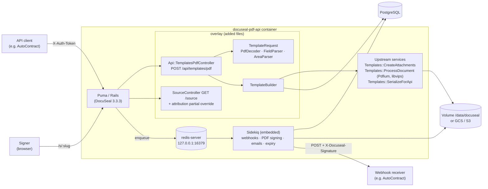

# Architecture

docuseal-pdf-api is the official DocuSeal 3.3.3 container plus an overlay of added Ruby files.
At runtime it is a single Rails/Puma process (single mode, `WEB_CONCURRENCY=0`) that also runs
Sidekiq (embedded) and, unless `REDIS_URL` is set, a local `redis-server` on 127.0.0.1:16379.
PostgreSQL holds all records; documents go to the local volume or object storage (GCS/S3).

## Components

## Request flow of POST /api/templates/pdf

1. `config/routes.rb` (upstream) runs `ActiveSupport.run_load_hooks(:routes, self)`; the
   overlay initializer adds `POST /api/templates/pdf` inside the `api` namespace.
2. `Api::TemplatesPdfController < Api::ApiBaseController` – authentication via `X-Auth-Token`
   (SHA-256 lookup of the access token), `authorize!(:create, template)` with upstream's
   CanCanCan ability, JSON error handling.
3. `DocusealPdfApi::TemplateRequest.parse` validates the whole payload and collects every
   problem (422 with `error` + `errors`); `PdfDecoder` decodes base64, checks `%PDF-` and the
   size, and opens the PDF with Pdfium for the page count. Nothing is written before
   validation passes.
4. `DocusealPdfApi::TemplateBuilder.call` (one database transaction): template attributes,
   one submitter per distinct role, then per document
   `Templates::CreateAttachments.handle_pdf_or_image` (stores the blob, link annotations,
   page previews via `Templates::ProcessDocument`), the schema entry and the fields
   (`submitter_uuid`, areas with `attachment_uuid`, page converted to 0-based).
5. `template.created` webhook jobs and the search reindex are enqueued like for UI uploads.
6. The response is `Templates::SerializeForApi` – identical to `GET /api/templates/:id`.

## Signing and webhooks (unchanged upstream)

`POST /api/submissions` creates submitters with `/s/:slug` links. Completion (signing form or
`PUT /api/submitters/:id` with `completed: true`) enqueues `ProcessSubmitterCompletionJob`,
which generates the signed PDFs (HexaPDF, PKCS#7 signature with the account certificate), the
audit log, and the `form.completed` / `submission.completed` webhook jobs. Webhook requests are
signed with HMAC-SHA256 (`X-Docuseal-Signature`) and retried with exponential backoff – see
[webhooks.md](webhooks.md).

## Build-time guards

The Dockerfile fails when a base-image bump breaks an assumption of the overlay:

- an overlay file would replace an upstream file;
- `config/routes.rb` no longer calls the `:routes` load hook;
- `app/views/shared/_attribution.html.erb` differs from the reviewed version (sha256).

## Decisions

- [ADR 0001](adr/0001-overlay-on-upstream-image.md) – overlay on the official image
- [ADR 0002](adr/0002-agpl-source-offer.md) – AGPL section 13 source offer
- [ADR 0003](adr/0003-api-semantics.md) – API semantics and differences from DocuSeal Pro
